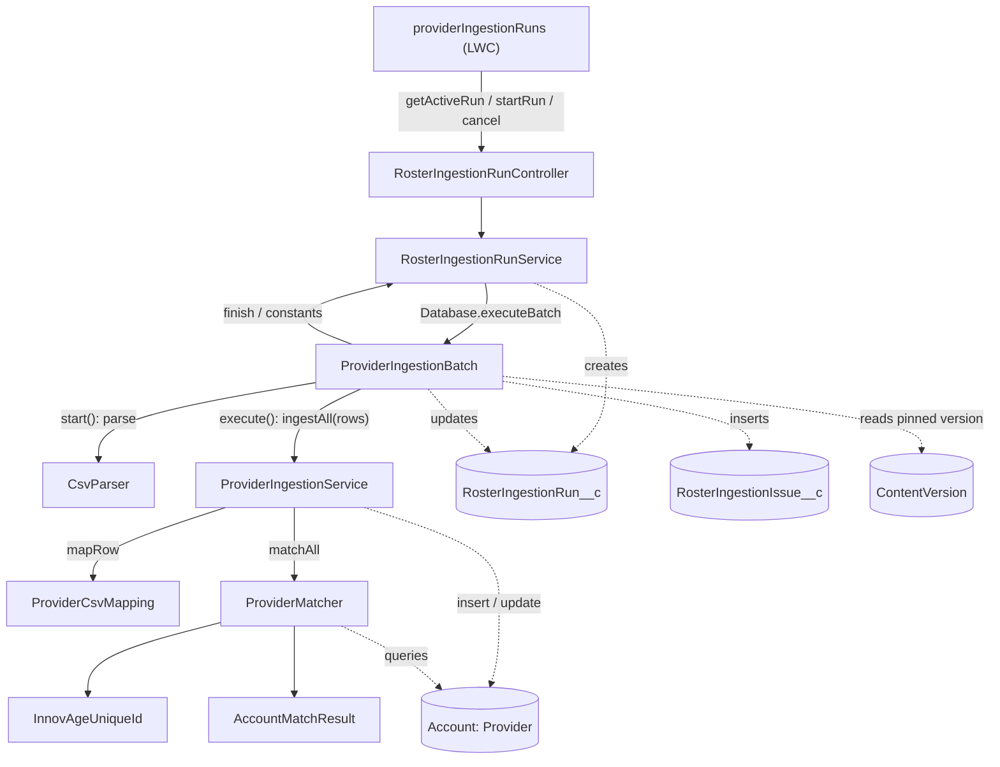
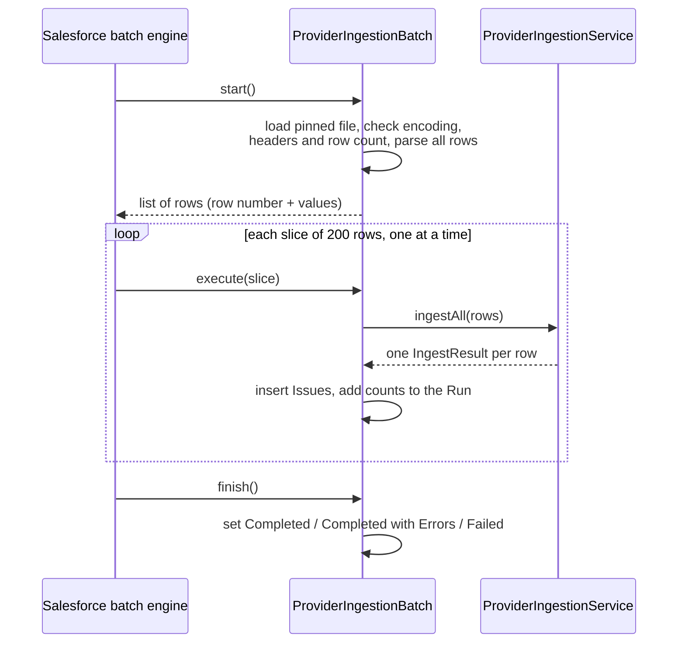
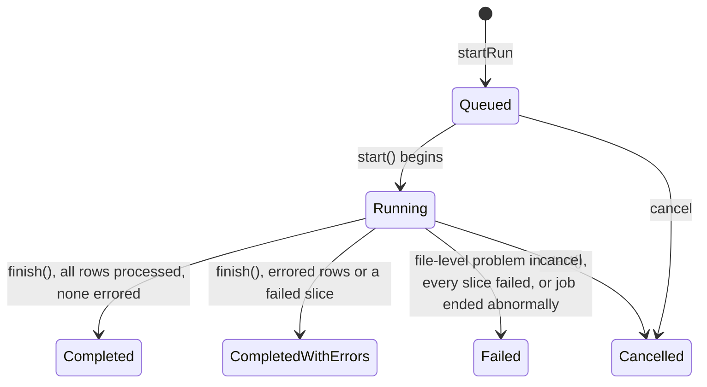

# Provider bulk ingestion: how it works

This document describes the bulk Provider ingestion feature **as it is
implemented** (October 2026): what each class and object does, how they call
each other, and what happens to a file from the moment a user clicks *Ingest*
until the run finishes.

For the history of the design, see
[docs/plans/provider-bulk-ingestion.md](../plans/provider-bulk-ingestion.md).
For why rows are processed one slice at a time rather than in parallel, see
[docs/plans/parallel-chunk-processing.md](../plans/parallel-chunk-processing.md).

## 1. What it does

A `RosterIngestion__c` record holds a **personnel file**: a CSV of Providers,
stored as a Salesforce File (ContentDocument). Bulk ingestion reads every row of
that file. For each row it either creates a Provider (a person Account with the
Provider record type), updates an existing one, or reports why the row could
not be ingested.

Each processing of a file is recorded as a **Run** (`RosterIngestionRun__c`).
Every error or warning found is recorded as an **Issue**
(`RosterIngestionIssue__c`).

The work is done by a **Batch Apex** job (`ProviderIngestionBatch`). Files are
limited to **5,000 rows**.

## 2. Batch Apex in brief

A batch class has three methods, and Salesforce calls them for us:

- **`start()`** runs once and returns the complete list of work items.
  Salesforce keeps that list.
- **`execute(scope)`** runs once per **slice** of that list (200 items here),
  each in its own transaction with fresh governor limits, one slice after
  another.
- **`finish()`** runs once, after the last slice.

If a slice throws, only that slice is rolled back. The job continues with the
next slice, and `finish()` still runs. There is no automatic retry.

Values set in `start()` reach `execute()` only if the class implements
`Database.Stateful`. We use it to carry the CSV header row.

## 3. Components

### Apex classes

| Class | Responsibility |
|---|---|
| `RosterIngestionRunController` | `@AuraEnabled` entry points for the `providerIngestionRuns` LWC: `getActiveRun` (first fails any stuck Run, then returns the roster's Queued or Running Provider Run, or null), `startRun` and `cancel`. Converts `RunException` into `AuraHandledException`. |
| `RosterIngestionRunService` | The user actions: start a Run (pin the file version, create the Run, launch the batch), cancel. Also holds the shared constants, `finish()` (set a Run's final status), and `failAbandonedRuns()`. |
| `ProviderIngestionBatch` | The processing. `start()` loads and parses the whole file; `execute()` ingests one slice of rows and records Issues and counts; `finish()` sets the final status. |
| `ProviderIngestionService` | Row logic. `ingestAll(rows)`: maps the rows, matches them against existing Providers, and performs the inserts and updates. `ingest(row)` is the single-row form. |
| `ProviderCsvMapping` | Maps CSV headers to Account fields. Validates and normalizes values (phone, email, dates, SSN, NPI, state, ZIP) and defines each field's update policy (OVERWRITE, FILL_IF_BLANK, INSERT_ONLY). Invalid values are dropped as warnings. |
| `ProviderMatcher` | `matchAll(requests)`: finds the existing Provider for each row by Unique ID and/or NPI, with **one** query for all rows. |
| `AccountMatchResult` | The outcome of matching one row: UNIQUE_MATCH, NO_MATCH, or an error outcome. |
| `InnovAgeUniqueId` | Parses and validates an InnovAge Unique ID (`P` + 9-digit auto-number + 3-character Id suffix). |
| `CsvParser` | RFC 4180 CSV parser. `parse()` returns every record; `toHeaders()` trims and validates the header row. |

### Data, UI and access

| Component | Responsibility |
|---|---|
| `RosterIngestion__c` (display fields) | Shown on the RosterIngestion tab's list views and the record page header (compact layout). Provider Runs counts the roster's personnel-file Runs, and Last Provider Run is the latest of their start times. Both are roll-up summaries that Salesforce keeps current, so no code is involved. Personnel File Uploaded and Relationships File Uploaded are checkbox formulas. The files' names are not shown: the file fields hold a ContentDocument Id as text, which a formula cannot follow. |
| `RosterIngestionRun__c` | One processing of one file version; a Master-Detail child of `RosterIngestion__c`. Holds the status, the pinned file version, Total Rows, the outcome counters and the batch job Id. |
| `RosterIngestionIssue__c` | One error or warning for one CSV row; a Master-Detail child of the Run. |
| `providerIngestionRuns` (LWC) | The "Provider Ingestion" control panel on the RosterIngestion record page. It has an *Ingest Providers* button, which asks for confirmation and is disabled while a run is active. While a Provider run is Queued or Running, it shows that run with a progress bar, the counts so far and a *Cancel* button, and refreshes every 3 s. When the run ends, it fires a standard page refresh so the run appears in the Provider Ingestion Runs list and the header counts update. The name is provider-specific for now; a more general name, or a second panel, will be decided when relationships ingestion is designed. |
| `RosterIngestion_Record_Page` | The RosterIngestion record page: details, the `rosterIngestionFiles` panel, the `providerIngestionRuns` control panel, then **Provider Ingestion Runs**. That list is a standard Dynamic Related List of the roster's finished Provider runs (File Type = Personnel; Status Completed, Completed with Errors, Failed or Cancelled), newest first. It shows Name, Status, Started At, Total Rows, Rows Processed, Inserted, Updated, Errored, Rows With Warnings and Failure Message, and has no action bar. Active runs appear only in the control panel. |
| `RosterIngestionRun_Record_Page` | The Run record page (desktop): the Run's details and counters, then **Errors** and **Warnings** tabs. Each tab is a standard Dynamic Related List of the Run's Issues, filtered by Severity and sorted by Row Number, showing Severity, Row, Code, Column, Message and Provider. View All keeps the filter and scrolls through every Issue. Standard components are preferred over custom ones here, which is why there is no custom Issues component. |
| `Roster_Ingestion_Files` (permission set) | Grants Read on Runs and Issues and their fields, Read/Edit on RosterIngestion, and access to the controllers. |

## 4. How the classes relate

The layers have clear boundaries:

- **`RosterIngestionRunService`** handles what users do with Runs.
- **`ProviderIngestionBatch`** handles files and slices: it turns CSV records
  into `RowInput`s, and `IngestResult`s into Issues and counters.
- **Row logic** (`ProviderIngestionService` and below) knows only rows and
  results. It knows nothing about Runs, files or slices.

## 5. Lifecycle of a Run

### 5.1 Starting (synchronous, in the user's request)

`RosterIngestionRunService.startRun(rosterIngestionId)`:

1. Checks that the user can **edit** the roster (`UserRecordAccess`), then
   locks the roster row (`FOR UPDATE`) for the rest of this transaction.
2. Finds the personnel file's **latest version** and rejects files over 3 MB.
   This is a quick guard; the real limit is 5,000 rows, checked in `start()`.
3. Fails any active Run whose batch job has already ended (see section 7), then
   refuses to start if the roster still has a Queued or Running Run.
   - The lock in step 1 makes this check safe against two simultaneous clicks.
   - The check itself is what stops a second Run while one is processing,
     which takes minutes.
4. Inserts the Run with status **Queued**, pinning the ContentVersion Id,
   version number and checksum.
5. Launches `ProviderIngestionBatch` with `Database.executeBatch(..., 200)` and
   stores the job Id on the Run.

### 5.2 Processing (asynchronous, Batch Apex)

**`start()`** (once):

1. Locks the Run. If it is no longer Queued (it was cancelled), returns an
   empty list. Otherwise it sets the status to **Running**.
2. Loads the pinned file version as text and parses all of it.
3. Checks that the file isn't empty and has the required columns (Provider
   Unique ID, Individual NPI, Last Name), and that it has at most 5,000 data
   rows.
4. Stores the header on the batch object (`Database.Stateful`) and Total Rows on
   the Run.
5. Returns one `RowItem` per data row: its spreadsheet row number and its values
   as a list. The header names are stored once rather than in every row.

Any file-level problem marks the Run **Failed** and returns an empty list, so no
slice runs.

**`execute(slice)`** (once per 200 rows):

1. Locks the Run. If it is no longer Running (it was cancelled), does nothing.
2. Turns each row into a header → value map. A row with the wrong number of
   columns becomes a COLUMN_COUNT Issue instead.
3. Calls `ProviderIngestionService.ingestAll(rows)`.
4. Turns each result into counter increments (Rows Processed, Inserted,
   Updated, Unchanged, Errored, Rows With Warnings) and Issues: one Error Issue
   per error, and one Warning Issue per dropped value.
5. Inserts the Issues and saves the counters.

All of a slice's work commits together, or not at all.

**`finish()`** (once):

- If the Run is no longer Running (it failed in `start()` or was cancelled),
  does nothing.
- If Rows Processed is less than Total Rows, some slice failed. The Run becomes
  **Completed with Errors**, or **Failed** if no row was processed. The failure
  message gives the number of missing rows and the job's error.
- Otherwise the Run becomes **Completed**, or **Completed with Errors** if any
  row errored.

### 5.3 Status transitions

## 6. Inside a slice: `ProviderIngestionService.ingestAll`

For a list of rows it:

1. **Maps** each row with `ProviderCsvMapping.mapRow`. This yields the key
   values (Unique ID and NPI), the valid normalized field values, and a warning
   for every dropped value. Warnings never contain the value itself.
2. **Matches** all rows at once with `ProviderMatcher.matchAll`:
   - Rows with no key, or a malformed key, get an error result immediately.
   - The other rows' keys are combined into **one** query.
   - Each row is then evaluated against the Providers its keys identify:
     - A supplied Unique ID must exist (otherwise UNKNOWN_UNIQUE_ID).
     - If the two keys identify different Providers, the result is
       MULTIPLE_MATCHES.
     - If the matched Provider's stored NPI differs from the row's NPI, the
       result is KEY_MISMATCH.
     - Otherwise the result is UNIQUE_MATCH, or NO_MATCH when no Provider is
       found.
3. **Plans** each row:
   - UNIQUE_MATCH: an update of the fields that changed. Each field's update
     policy is respected, and blank or invalid values are never written. A row
     with nothing to change is UNCHANGED.
   - NO_MATCH: an insert. A valid Last Name is required.
   - Any other outcome: an error.
4. **Saves** with at most one partial-success `Database.insert` and one
   `Database.update`, in system mode. Each save result is mapped back to the row
   that produced it; a failed save becomes a SAVE_ERROR on that row.

### Duplicate rows

Rows are not checked against each other; the stakeholder accepts duplicates.
What happens depends on whether the duplicate rows land in the same slice:

| Where the rows land | Result |
|---|---|
| Different slices | The first row inserts the Provider; later rows update it (or find it unchanged). |
| Same slice, new Provider | All are planned as inserts; the database rejects all but the first because `NPI__c` is unique (SAVE_ERROR). |
| Same slice, existing Provider | The rows' changes are merged into one update, because Salesforce rejects a DML list holding the same Id twice. Each row reports its own changes; the last row wins a field that several rows change. |

## 7. Failure handling

| What goes wrong | Where | Result |
|---|---|---|
| Invalid value in a field (bad phone, ZIP, …) | `ProviderCsvMapping` | The value is dropped and a **Warning** Issue (INVALID_VALUE) is recorded. The rest of the row is ingested. |
| Row cannot be matched or saved | `ProviderMatcher` / `ProviderIngestionService` | An **Error** Issue is recorded with a code: a match outcome, MISSING_LAST_NAME, SAVE_ERROR or COLUMN_COUNT. Other rows are unaffected. |
| File-level problem: not UTF-8, empty, malformed CSV, missing required column, more than 5,000 rows, file version deleted | `ProviderIngestionBatch.start()` | The Run is **Failed** with the reason. No rows are processed. |
| A slice throws, including on a governor limit | Salesforce | That slice is rolled back and the job moves on. `finish()` reports the missing rows (Completed with Errors, or Failed if every slice failed). Re-running the file is safe: rows already ingested come out UNCHANGED. |
| The job dies where the batch can't record it (e.g. a governor limit in `start()`) | `RosterIngestionRunService.failAbandonedRuns` | The Run would stay Queued or Running. Whenever runs are listed, and before a new Run starts, any active Run whose batch job has ended (Completed, Failed or Aborted) is marked **Failed**, with the job's error. |
| User cancels | `RosterIngestionRunService.cancel` | The Run is marked **Cancelled** and the batch job is aborted. A slice already in progress still commits; later slices find the Run cancelled and do nothing. |

## 8. Access and security

- Starting and cancelling check that the user can edit the roster.
  After that, Runs and Issues are written in **system mode**.
- `ProviderMatcher` is `without sharing` and queries in system mode, and
  Provider DML runs in system mode. Ingestion must see and write every Provider
  regardless of who uploaded the file; otherwise it would create duplicates of
  Providers the uploader cannot see.
- The batch job runs as the user who started the Run.
- Users need the `Roster_Ingestion_Files` permission set to see Runs and
  Issues. The classes use API 67.0, which applies field-level security by
  default.
- Issue messages never contain field values. Sensitive values such as SSN and
  date of birth never appear in them.

## 9. Limits and measurements

| Setting | Value | Where |
|---|---|---|
| Maximum rows per file | 5,000 | `ProviderIngestionBatch.maxRows` |
| Maximum file size | 3 MB: a quick guard before the job starts; a 5,000-row file is about 1.7 MB | `RosterIngestionRunService.maxFileBytes` |
| Rows per slice | 200 | `RosterIngestionRunService.BATCH_SIZE` |
| Encoding | UTF-8 only | `ProviderIngestionBatch.loadFile` |
| Row numbers | Spreadsheet rows, with the header as row 1 | `ProviderIngestionBatch.start` |

Measured in the `innovage` sandbox (2026-10-15), with a 5,000-row run:

- **Whole run:** 3½ minutes, in 25 slices.
- **`start()`** (load and parse 5,000 rows): 9.7 s from start to finish.
  Salesforce does not report CPU or heap for a batch `start()`. CPU is
  therefore at most 9.7 s of 60 s. Heap is estimated at about 5 MB of 12 MB:
  roughly 1.7 MB of text plus 3.1 MB of parsed rows.
- **Each slice:** 0.5–0.6 s of CPU per 200 rows.

## 10. Testing

- A test can run only **one** `execute()` of a real batch job. The tests in
  `RosterIngestionRunServiceTest` therefore drive the batch directly:
  `start(null)`, then `execute(null, slice)` for each slice, then
  `finish(null)`, which is what Salesforce does. This lets them use several
  slices and simulate a failed slice by skipping it.
- The batch queued by `startRun` runs at `Test.stopTest()`. When a test has
  already driven the Run to completion, that job finds the Run finished and
  does nothing.
- Tests run as a user with the `Roster_Ingestion_Files` permission set
  (`ProviderTestDataFactory.createIngestionUser` and `System.runAs`), because
  API 67.0 enforces field-level security in test code too.
- `scripts/generate_roster_csv.py` generates synthetic roster files. Use
  `--existing-ids` to include update rows.
