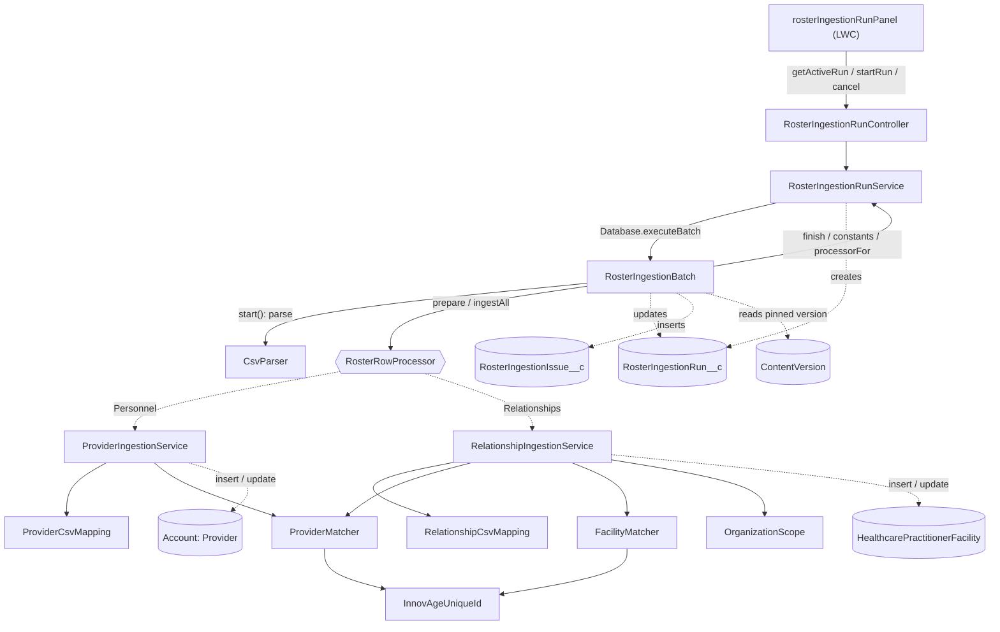
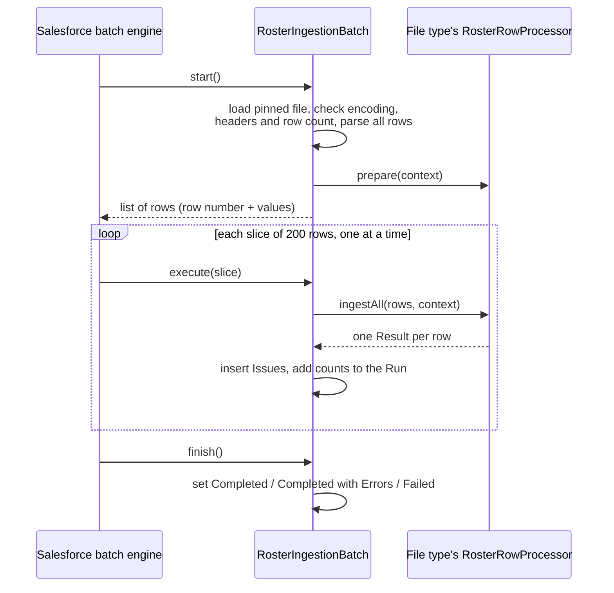
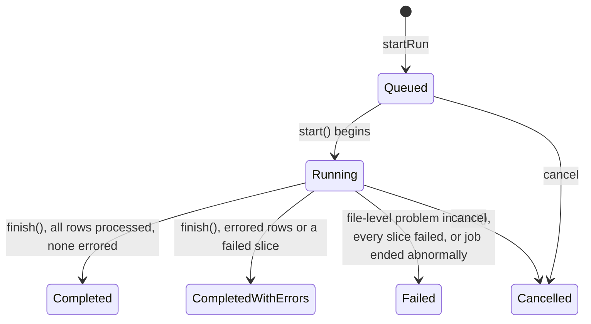

# Roster ingestion: how it works

This document describes roster file ingestion **as it is implemented**
(October 2026): what each class and object does, how they call each other, and
what happens to a file from the moment a user clicks *Ingest* until the run
finishes.

A roster has two files, and each is ingested the same way by a shared
pipeline:

| File | What a row does | Row processing |
|---|---|---|
| **Personnel** | Creates or updates a Provider (a person Account with the Provider record type) | `ProviderIngestionService` |
| **Relationships** | Creates or terminates a relationship between a Provider and a Healthcare Facility | `RelationshipIngestionService` |

History and decisions:
[docs/plans/provider-bulk-ingestion.md](../plans/provider-bulk-ingestion.md)
(personnel),
[docs/plans/relationships-ingestion.md](../plans/relationships-ingestion.md)
(relationships). For why rows are processed one slice at a time rather than in
parallel, see
[docs/plans/parallel-chunk-processing.md](../plans/parallel-chunk-processing.md).

## 1. What it does

A `RosterIngestion__c` record belongs to an **Organization** and holds up to two
files, stored as Salesforce Files (ContentDocument). Ingestion reads every row
of one file and reports, for each row, what was done or why it could not be.

Each processing of a file is recorded as a **Run** (`RosterIngestionRun__c`,
with File Type Personnel or Relationships). Every error or warning found is
recorded as an **Issue** (`RosterIngestionIssue__c`).

The work is done by a **Batch Apex** job (`RosterIngestionBatch`). Files are
limited to **5,000 rows**.

## 2. Batch Apex in brief

A batch class has three methods, and Salesforce calls them for us:

- **`start()`** runs once and returns the complete list of work items.
  Salesforce keeps that list.
- **`execute(scope)`** runs once per **slice** of that list (200 items here),
  each in its own transaction with fresh governor limits, one slice after
  another.
- **`finish()`** runs once, after the last slice.

If a slice throws, only that slice is rolled back. The job continues with the
next slice, and `finish()` still runs. There is no automatic retry.

Values set in `start()` reach `execute()` only if the class implements
`Database.Stateful`. We use it to carry the CSV header row, the file type's
row processor and the Run's context.

## 3. Components

### Shared pipeline

| Class | Responsibility |
|---|---|
| `RosterIngestionRunController` | `@AuraEnabled` entry points for the `rosterIngestionRunPanel` LWC: `getActiveRun(recordId, fileType)` (first fails any stuck Run, then returns the roster's Queued or Running Run of that type, or null), `startRun(recordId, fileType)` and `cancel`. Converts `RunException` into `AuraHandledException`. |
| `RosterIngestionRunService` | The user actions: start a Run of a file type (pin the file version, create the Run, launch the batch), cancel. Also holds the shared constants, `processorFor(fileType)`, `finish()` (set a Run's final status) and `failAbandonedRuns()`. |
| `RosterIngestionBatch` | The processing, for any file type. `start()` loads and parses the whole file and prepares the Run's context; `execute()` hands one slice of rows to the file type's processor and records Issues and counts; `finish()` sets the final status. |
| `RosterRowProcessor` | The interface each file type implements: `requiredHeaders()`, `prepare(context)` (once per Run) and `ingestAll(rows, context)` (once per slice). |
| `RosterIngestionRow` | The shared types: `Input` (row number and values), `Result` (outcome, error, warnings, values to copy onto Issues), `Warning`, and `Context` (roster, Organization, run date, Organization scope). |
| `CsvParser` | RFC 4180 CSV parser. `parse()` returns every record; `toHeaders()` trims and validates the header row. |

### Personnel file

| Class | Responsibility |
|---|---|
| `ProviderIngestionService` | Row logic. `ingestAll(rows)`: maps the rows, matches them against existing Providers, and performs the inserts and updates. `ingest(row)` is the single-row form. Its `Processor` adapts it to `RosterRowProcessor`. |
| `ProviderCsvMapping` | Maps CSV headers to Account fields. Validates and normalizes values (phone, email, dates, SSN, NPI, state, ZIP, picklists, and multi-select picklists split on `MULTI_PICKLIST_SEPARATOR`, currently `;`) and defines each field's update policy (OVERWRITE, FILL_IF_BLANK, INSERT_ONLY). Invalid values are dropped as warnings. `parseDate` is shared with the relationships file. The full column list is in [docs/specs/personnel-file-mapping.csv](../specs/personnel-file-mapping.csv). |
| `ProviderMatcher` | `matchAll(requests)`: finds the existing Provider for each row by Unique ID and/or NPI, with **one** query for all rows. Used by both file types. |
| `AccountMatchResult` | The outcome of matching one row: UNIQUE_MATCH, NO_MATCH, or an error outcome. |
| `InnovAgeUniqueId` | Parses and validates an InnovAge Unique ID (prefix + 9-digit auto-number + 3-character Id suffix; `P` for Providers, `MF` for facilities). |

### Relationships file

| Class | Responsibility |
|---|---|
| `RelationshipIngestionService` | Row logic (section 7). `ingestAll(rows, context)`: reads the rows, matches Providers and facilities, plans each row against a ledger of the slice's relationships, then saves with at most one update and one insert. `ingest(row, organizationId)` is the single-row form. Its `Processor` computes the Organization scope in `prepare`. |
| `RelationshipCsvMapping` | The column names, the Terminate value (blank / Single / All) and the start date. |
| `OrganizationScope` | `forOrganization(id)`: the Organization and every Organization below it (`Account.ParentId`), one query per level. |
| `FacilityMatcher` | `matchAll(requests, organizationId, scope)`: finds the facility for each row by Unique ID, NPI or address, and checks that it is in scope. At most two queries for all rows. |

### Data, UI and access

| Component | Responsibility |
|---|---|
| `RosterIngestion__c` (display fields) | Shown on the RosterIngestion tab's list views and the record page header (compact layout). Provider Runs / Relationship Runs count the roster's Runs of each file type, and Last Provider Run / Last Relationship Run are the latest of their start times. All four are roll-up summaries that Salesforce keeps current, so no code is involved. Personnel File Uploaded and Relationships File Uploaded are checkbox formulas. The files' names are not shown: the file fields hold a ContentDocument Id as text, which a formula cannot follow. |
| `RosterIngestionRun__c` | One processing of one file version; a Master-Detail child of `RosterIngestion__c`. Holds the file type, status, the pinned file version, Total Rows, the outcome counters (Inserted, Updated, Terminated, Unchanged, Errored, Rows With Warnings) and the batch job Id. The counters count **rows**. |
| `RosterIngestionIssue__c` | One error or warning for one CSV row; a Master-Detail child of the Run. Links the Provider (both file types) and, for relationships, the facility, and keeps the row's key values. |
| `RosterIngestionRun__c.Results__c` | A text formula that summarizes a Run's counts in one column, e.g. "5000 rows · 4966 new · 34 err · 44 warn". The abbreviations are new = inserted (Providers or relationships), upd = updated, term = rows that terminated relationships, same = unchanged, err = errors, warn = rows with warnings. Zero counts are left out. The rows part reads "1200 of 5000 rows" when not every row was processed. The individual count fields remain the source for sorting, filtering and reports. |
| `rosterIngestionRunPanel` (LWC) | The control panel for one file type, chosen by its App Builder property **File Type**. The roster page has two: "Provider Ingestion" and "Relationship Ingestion". It has an *Ingest …* button, which asks for confirmation and is disabled while a run of its type is active. While a run is Queued or Running, it shows that run with a progress bar, the counts so far and a *Cancel* button, and refreshes every 3 s. When the run ends, it fires a standard page refresh so the run appears in its runs list and the header counts update. |
| `RosterIngestion_Record_Page` | The RosterIngestion record page: details, the `rosterIngestionFiles` panel, then for each file type its control panel and its runs list (**Provider Ingestion Runs**, **Relationship Ingestion Runs**). Each list is a standard Dynamic Related List of the roster's finished Runs of that type (Status Completed, Completed with Errors, Failed or Cancelled), newest first, showing Name, Status, Started At, Results, Failure Message, Created By and Version Number, with no action bar. Active runs appear only in the control panels. |
| `RosterIngestionRun_Record_Page` | The Run record page (desktop): the Run's details and counters, then **Errors** and **Warnings** tabs. Each tab is a standard Dynamic Related List of the Run's Issues, filtered by Severity and sorted by Row Number, showing Severity, Row, Code, Column, Message, Provider and Facility. Standard components are preferred over custom ones here, which is why there is no custom Issues component. |
| `Roster_Ingestion_Files` (permission set) | Grants Read on Runs and Issues and their fields, Read/Edit on RosterIngestion, and access to the controllers. |

## 4. How the classes relate

The layers have clear boundaries:

- **`RosterIngestionRunService`** handles what users do with Runs.
- **`RosterIngestionBatch`** handles files and slices: it turns CSV records
  into `RosterIngestionRow.Input`s, and `Result`s into Issues and counters. It
  knows nothing about any file type's rows.
- **Row logic** (each file type's service and below) knows only rows and
  results. It knows nothing about Runs, files or slices.

## 5. Lifecycle of a Run

### 5.1 Starting (synchronous, in the user's request)

`RosterIngestionRunService.startRun(rosterIngestionId, fileType)`:

1. Checks that the user can **edit** the roster (`UserRecordAccess`), then
   locks the roster row (`FOR UPDATE`) for the rest of this transaction.
2. Finds the file type's file's **latest version** and rejects files over
   3 MB. This is a quick guard; the real limit is 5,000 rows, checked in
   `start()`.
3. Fails any active Run whose batch job has already ended (see section 8), then
   refuses to start if the roster still has a Queued or Running Run **of any
   file type**. Different rosters run independently.
   - The lock in step 1 makes this check safe against two simultaneous clicks.
   - The check itself is what stops a second Run while one is processing,
     which takes minutes.
4. Inserts the Run with status **Queued** and the file type, pinning the
   ContentVersion Id, version number and checksum.
5. Launches `RosterIngestionBatch` with `Database.executeBatch(..., 200)` and
   stores the job Id on the Run.

### 5.2 Processing (asynchronous, Batch Apex)

**`start()`** (once):

1. Locks the Run. If it is no longer Queued (it was cancelled), returns an
   empty list. Otherwise it sets the status to **Running**.
2. Picks the processor for the Run's file type.
3. Loads the pinned file version as text and parses all of it.
4. Checks that the file isn't empty and has the processor's required columns,
   and that it has at most 5,000 data rows.
5. Builds the Run's context (roster, its Organization, the run date) and lets
   the processor add to it (`prepare`). The relationships processor computes
   the Organization scope here, once for the whole Run.
6. Stores the header, processor and context on the batch object
   (`Database.Stateful`) and Total Rows on the Run.
7. Returns one `RowItem` per data row: its spreadsheet row number and its values
   as a list. The header names are stored once rather than in every row.

Any file-level problem marks the Run **Failed** and returns an empty list, so no
slice runs.

**`execute(slice)`** (once per 200 rows):

1. Locks the Run. If it is no longer Running (it was cancelled), does nothing.
2. Turns each row into a header → value map. A row with the wrong number of
   columns becomes a COLUMN_COUNT Issue instead.
3. Calls the processor's `ingestAll(rows, context)`.
4. Turns each result into counter increments (Rows Processed, then Inserted,
   Updated, Terminated, Unchanged or Errored, and Rows With Warnings) and
   Issues: one Error Issue per error, and one Warning Issue per warning. Each
   Issue gets the row's key values (Provider, facility, keys as supplied).
5. Inserts the Issues and saves the counters.

All of a slice's work commits together, or not at all.

**`finish()`** (once):

- If the Run is no longer Running (it failed in `start()` or was cancelled),
  does nothing.
- If Rows Processed is less than Total Rows, some slice failed. The Run becomes
  **Completed with Errors**, or **Failed** if no row was processed. The failure
  message gives the number of missing rows and the job's error.
- Otherwise the Run becomes **Completed**, or **Completed with Errors** if any
  row errored.

### 5.3 Status transitions

## 6. Personnel file: inside a slice (`ProviderIngestionService.ingestAll`)

Required columns: Provider Unique ID, Individual NPI, Last Name.

For a list of rows it:

1. **Maps** each row with `ProviderCsvMapping.mapRow`. This yields the key
   values (Unique ID and NPI), the valid normalized field values, and a warning
   for every dropped value. Warnings never contain the value itself.
2. **Matches** all rows at once with `ProviderMatcher.matchAll`:
   - Rows with no key, or a malformed key, get an error result immediately.
   - The other rows' keys are combined into **one** query.
   - Each row is then evaluated against the Providers its keys identify:
     - A supplied Unique ID must exist (otherwise UNKNOWN_UNIQUE_ID).
     - If the two keys identify different Providers, the result is
       MULTIPLE_MATCHES.
     - If the matched Provider's stored NPI differs from the row's NPI, the
       result is KEY_MISMATCH.
     - Otherwise the result is UNIQUE_MATCH, or NO_MATCH when no Provider is
       found.
3. **Plans** each row:
   - UNIQUE_MATCH: an update of the fields that changed. Each field's update
     policy is respected, and blank or invalid values are never written. A row
     with nothing to change is UNCHANGED.
   - NO_MATCH: an insert. A valid Last Name is required.
   - Any other outcome: an error.
4. **Saves** with at most one partial-success `Database.insert` and one
   `Database.update`, in system mode. Each save result is mapped back to the row
   that produced it; a failed save becomes a SAVE_ERROR on that row.

### Duplicate rows

Rows are not checked against each other; the stakeholder accepts duplicates.
What happens depends on whether the duplicate rows land in the same slice:

| Where the rows land | Result |
|---|---|
| Different slices | The first row inserts the Provider; later rows update it (or find it unchanged). |
| Same slice, new Provider | All are planned as inserts; the database rejects all but the first because `NPI__c` is unique (SAVE_ERROR). |
| Same slice, existing Provider | The rows' changes are merged into one update, because Salesforce rejects a DML list holding the same Id twice. Each row reports its own changes; the last row wins a field that several rows change. |

## 7. Relationships file: inside a slice (`RelationshipIngestionService.ingestAll`)

A relationship is a `HealthcarePractitionerFacility` (HPF) linking a Provider's
`HealthcareProvider` (found through `Account.Healthcare_Provider__c`) to a
facility's `HealthcareFacility` (found through `Account.Healthcare_Facility__c`).
It is **active** when `IsActive` is true and `TerminationDate` is blank.
HealthcareFacility is assumed to be one-to-one with its facility Account, so
the pointer is the only link considered.

Required columns (values may be blank): Provider Unique ID, Individual NPI,
Facility Unique ID, Facility NPI, Facility Shipping Address, Relationship Start
Date, Terminate.

### 7.1 Organization scope

A roster speaks for its **Organization and every Organization below it**
(children through `Account.ParentId`, their children, and so on; never its
parents). A facility is **in scope** when its HealthcareFacility's
`Legal_Owner__c` is one of these Organizations. Only relationships at in-scope
facilities are ever changed.

The scope is computed once per Run, in `start()` (`prepare`), one query per
level of the hierarchy, and carried to every slice in the context.

### 7.2 Steps

For a list of rows it:

1. **Reads** each row with `RelationshipCsvMapping.mapRow`. A Terminate value
   other than blank, Single or All is an error (INVALID_TERMINATE_VALUE). On a
   create row, a malformed start date is an error too (INVALID_START_DATE), so
   the user can correct it. Terminate rows ignore the start date, with a
   START_DATE_IGNORED warning if one is given. A Terminate All row with facility
   columns filled in gets a FACILITY_COLUMNS_IGNORED warning.
2. **Matches Providers** with `ProviderMatcher.matchAll`, as for the personnel
   file, except that NO_MATCH is an error (UNKNOWN_PROVIDER: this file never
   creates Providers) and the Provider must have a HealthcareProvider
   (PROVIDER_NOT_SET_UP).
3. **Matches facilities** (create and Terminate Single rows) with
   `FacilityMatcher.matchAll`:
   1. A **Facility Unique ID** must identify a facility
      (UNKNOWN_FACILITY_UNIQUE_ID). A given NPI or address that differs from
      the facility's non-blank one is FACILITY_KEY_MISMATCH. The address rule
      is deliberately strict for now and marked REVISIT in the code.
   2. Otherwise a **Facility NPI** (`Account.Group_Type_2_NPI__c`, not unique)
      must identify exactly one facility in scope: none is FACILITY_NOT_FOUND,
      several is MULTIPLE_FACILITY_MATCHES. A given address must agree.
   3. Otherwise the **address** (first line of `ShippingStreet`, compared
      ignoring case, extra whitespace and trailing punctuation) must identify
      exactly one facility in scope.
   4. No facility key at all is NO_FACILITY_KEY_VALUES.

   Then the facility must be in scope. Otherwise the error is
   FACILITY_NOT_IN_ORGANIZATION, and the message names the facility's Legal
   Owner (or says it has none) and the roster's Organization.
4. **Queries** the active HPFs of the slice's Providers (one query).
   Terminated HPFs are never changed, so they are not loaded.
5. **Plans** each row in file order against a **ledger** of the slice's
   relationships, keyed by (HealthcareProvider, HealthcareFacility):

   | Terminate | Ledger state | Result | Outcome |
   |---|---|---|---|
   | blank | no active HPF | New HPF: Name "Provider @ Facility", both links, `IsActive = true`, `InitialStartDate` from the file. Nothing else is set (not `AccountId`, `PractitionerId`, `Predecessor_Record__c`, `EffectiveFrom` or `EffectiveTo`). A Provider who returns to a facility gets a new HPF; the terminated one is left as it is | INSERTED |
   | blank | active HPF | Nothing: the start date is only written when an HPF is created. A file date that differs from the stored one, or is given when none is stored, gets a START_DATE_DIFFERS warning saying no change was made | UNCHANGED |
   | Single | active HPF | `IsActive = false`, `TerminationDate` = run date | TERMINATED |
   | Single | none | Nothing; NO_ACTIVE_RELATIONSHIP warning | UNCHANGED |
   | All | — | Terminate every active HPF of the Provider at an in-scope facility; if none, NO_ACTIVE_RELATIONSHIP warning | TERMINATED / UNCHANGED |

   Several active HPFs for one pair should not exist. A row that touches them
   still proceeds (a terminate ends all of them; a create creates nothing), with
   a MULTIPLE_ACTIVE_RELATIONSHIPS warning so the data can be investigated.

6. **Saves** with at most one partial-success update (terminations) and then
   one insert, in system mode. A row whose record fails to save
   becomes a SAVE_ERROR.

Terminations set `IsActive` as well as `TerminationDate`, and new HPFs are
created with `IsActive = true` (the field defaults to false). This matters
because the org's `Provider_Plan_Participation_AutoCreate` and
`Provider_Plan_Participation_AutoEndDate` flows react to `IsActive` only.

### 7.3 Rows that touch the same relationship

Nothing in the database makes a (Provider, facility) relationship unique, so
the ledger in step 5 is what prevents duplicates. It lives only inside one
`ingestAll` call:

| Where the rows land | Result |
|---|---|
| Different slices | Each slice queries the database, which already holds the earlier slices' work. |
| Same slice, two creates | The second sees the first's pending insert and is UNCHANGED. |
| Same slice, create then terminate | One HPF is inserted, already terminated. |
| Same slice, terminate then create | The old HPF is terminated and a new one is inserted. |

### 7.4 Still provisional

The open questions and provisional decisions are tracked in
[relationships-open-questions.md](../plans/relationships-open-questions.md).
The ones that affect behaviour most: the definition of "active", address
disagreement being an error (marked REVISIT in the code), and the
single-line address.

## 8. Failure handling

| What goes wrong | Where | Result |
|---|---|---|
| Invalid value in a personnel field (bad phone, ZIP, …) | `ProviderCsvMapping` | The value is dropped and a **Warning** Issue (INVALID_VALUE) is recorded. The rest of the row is ingested. |
| Malformed relationship start date on a create row | `RelationshipIngestionService` | An **Error** Issue (INVALID_START_DATE); the row is not ingested. Terminate rows ignore the start date. |
| Row cannot be matched or saved | matchers / services | An **Error** Issue is recorded with a code (a match outcome, MISSING_LAST_NAME, a facility code, SAVE_ERROR, COLUMN_COUNT, …). Other rows are unaffected. |
| File-level problem: not UTF-8, empty, malformed CSV, missing required column, more than 5,000 rows, file version deleted | `RosterIngestionBatch.start()` | The Run is **Failed** with the reason. No rows are processed. |
| A slice throws, including on a governor limit | Salesforce | That slice is rolled back and the job moves on. `finish()` reports the missing rows (Completed with Errors, or Failed if every slice failed). Re-running the file is safe: rows already ingested come out UNCHANGED. |
| The job dies where the batch can't record it (e.g. a governor limit in `start()`) | `RosterIngestionRunService.failAbandonedRuns` | The Run would stay Queued or Running. Whenever runs are listed, and before a new Run starts, any active Run whose batch job has ended (Completed, Failed or Aborted) is marked **Failed**, with the job's error. |
| User cancels | `RosterIngestionRunService.cancel` | The Run is marked **Cancelled** and the batch job is aborted. A slice already in progress still commits; later slices find the Run cancelled and do nothing. |

## 9. Access and security

- Starting and cancelling check that the user can edit the roster.
  After that, Runs and Issues are written in **system mode**.
- The matchers (`ProviderMatcher`, `FacilityMatcher`, `OrganizationScope`) are
  `without sharing` and query in system mode, and Provider and relationship DML
  runs in system mode. Ingestion must see and write every record regardless of
  who uploaded the file; otherwise it would create duplicates of records the
  uploader cannot see, or compute a scope that depends on the uploader.
- The batch job runs as the user who started the Run.
- Users need the `Roster_Ingestion_Files` permission set to see Runs and
  Issues. The classes use API 67.0, which applies field-level security by
  default.
- Issue messages never contain Provider field values. Sensitive values such as
  SSN and date of birth never appear in them. Relationship messages name
  facilities and Organizations, which are not sensitive.

## 10. Limits and measurements

| Setting | Value | Where |
|---|---|---|
| Maximum rows per file | 5,000 | `RosterIngestionBatch.maxRows` |
| Maximum file size | 3 MB: a quick guard before the job starts; a 5,000-row personnel file is about 1.7 MB | `RosterIngestionRunService.maxFileBytes` |
| Rows per slice | 200, both file types | `RosterIngestionRunService.BATCH_SIZE` |
| Encoding | UTF-8 only | `RosterIngestionBatch.loadFile` |
| Row numbers | Spreadsheet rows, with the header as row 1 | `RosterIngestionBatch.start` |
| Organization hierarchy depth | 10 levels below the roster's Organization | `OrganizationScope.maxDepth` |

Measured in the `innovage` sandbox (2026-10-15), with a 5,000-row personnel
run:

- **Whole run:** 3½ minutes, in 25 slices.
- **`start()`** (load and parse 5,000 rows): 9.7 s from start to finish.
  Salesforce does not report CPU or heap for a batch `start()`. CPU is
  therefore at most 9.7 s of 60 s. Heap is estimated at about 5 MB of 12 MB:
  roughly 1.7 MB of text plus 3.1 MB of parsed rows.
- **Each slice:** 0.5–0.6 s of CPU per 200 rows.

Relationships runs have **not been measured yet**. Each created or terminated
HPF runs two flows, so their slices will cost more. If they come close to the
limits, the slice size can be made per file type.

## 11. Testing

- A test can run only **one** `execute()` of a real batch job. The tests in
  `RosterIngestionRunServiceTest` therefore drive the batch directly:
  `start(null)`, then `execute(null, slice)` for each slice, then
  `finish(null)`, which is what Salesforce does. This lets them use several
  slices and simulate a failed slice by skipping it.
- The batch queued by `startRun` runs at `Test.stopTest()`. When a test has
  already driven the Run to completion, that job finds the Run finished and
  does nothing.
- Tests run as a user with the `Roster_Ingestion_Files` permission set
  (`ProviderTestDataFactory.createIngestionUser` and `System.runAs`), because
  API 67.0 enforces field-level security in test code too.
- `RelationshipTestDataFactory` builds Organizations, facilities and Providers.
  The org's automation needs setup data that tests must create:
  - `createOwnershipRoles()` creates the Health Cloud reciprocal roles
    ("Parent Organization", "Facility Owner"). The org's `AARService`
    (another team's code) fails inserts of a child Organization or a
    HealthcareFacility with a Legal Owner without them.
  - Facility Accounts need a `Type` (validation rule).
  - The factory creates the HealthcareProvider / HealthcareFacility only if
    automation has not.
- `scripts/generate_roster_csv.py` generates synthetic personnel files. Use
  `--existing-ids` to include update rows.
- `scripts/apex/createRelationshipTestData.apex` creates sandbox test data for
  relationships: Organizations under Acme (the test rosters' Organization), an
  unrelated Beacon Health hierarchy, and 12 facilities with Legal Owners. Its
  header lists what each facility is for. It refuses to run twice.
